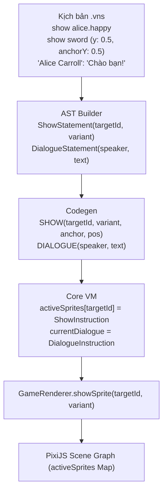

# TASK-unified-sprite-layer-refactor: Đại phẫu Kiến trúc — Chuẩn hóa Unified Sprite Layer & Xóa bỏ Phân mảnh Character-Asset

**Trạng thái**: SPECIFICATION UPDATED & READY (Pha 0 - Docs-First sau /grill-me)  
**Ngày lập**: 2026-11-09 | **Cập nhật kiến trúc toàn diện**: 2026-11-11  
**Phạm vi**: Toàn bộ Monorepo (`shared-types`, `dsl-compiler`, `core-vm`, `renderer`, `runtime-player`, `editor`)  
**Tài liệu liên quan**: [ADR-028](file:///d:/Git_Repo/vn_engine_web/docs/architecture/adr.md), [dsl spec.md](file:///d:/Git_Repo/vn_engine_web/docs/specifications/dsl%20spec.md), [system_architecture.md](file:///d:/Git_Repo/vn_engine_web/docs/architecture/system_architecture.md), [docs/tasks/note.md](file:///d:/Git_Repo/vn_engine_web/docs/tasks/note.md)

---

## 1. Lý do & Động lực Kỹ thuật (Technical Motivation)

### 1.1 Thực trạng & Nợ Kỹ thuật Trước Đại phẫu
1. **Phân mảnh Quản lý Tài nguyên (Dual Entity Debt)**:
   - Project lưu trữ 2 bảng riêng biệt: `project.characters` và `project.assets`.
   - Người dùng tải ảnh lên kho Asset, sau đó phải mở tab Nhân vật để map từng file ảnh vào từng biểu cảm (`sprites: { "happy": "asset-uuid" }`).
   - Đồ vật / Đạo cụ (prop, item) không có bảng riêng, bị cưỡng ép hoặc tạo thành nhân vật giả lập hoặc gọi trần qua asset, gây cảnh báo sai trên Editor Reconciler: *"Uncreated character 'key_gold'"*.
2. **Sự Phức tạp Thừa thãi trong Cú pháp DSL**:
   - DSL bắt buộc mọi lời thoại phải gắn với một `Character.id` đã định nghĩa trước.
   - Để đổi tên người nói hoặc giữ bí mật danh tính, kịch bản phải dùng các câu lệnh rườm rà: `reveal alice as "???"` hoặc `alice as "???": "..."`.
3. **Cơ chế Chắp vá ở Tầng Renderer**:
   - `GameRenderer` quản lý `activeCharacters` và API `showCharacter(..., isProp = false)` với các khối điều kiện `isProp ? 0.5 : 1.0` để ép điểm neo và vị trí.
   - `AssetResolverAdapter.checkIsProp` phải liên tục duyệt tìm chéo giữa `characters` và `assets` trên từng frame render.

### 1.2 Tầm nhìn Kiến trúc Mới (The Unified Sprite & Literal Speaker Vision)
- **Tập trung vào Triết lý Ren'Py**: Tách biệt hoàn toàn giữa **Tài nguyên Hình ảnh (Sprites)** và **Người phát ngôn (Speaker)**.
- **Loại bỏ Bảng `characters`**: Không còn bảng `characters` ở cấp Project. Toàn bộ hình ảnh (nhân vật, đồ vật, hiệu ứng) được quản lý tự nhiên trong `project.assets` thông qua 2 trường `tag` và `variant`.
- **Thoại Tên Trực tiếp (Literal Speaker)**: Cú pháp thoại cho phép dùng trực tiếp Identifier hoặc Chuỗi (`"Alice Carroll": "..."` hoặc `"???": "..."`). Loại bỏ hoàn toàn `reveal` và `as`.
- **Điểm neo & Vị trí Mặc định Đồng nhất**: Mọi sprite đều neo chân `(anchorX: 0.5, anchorY: 1.0)` tại đáy màn hình (`y = 1080`), cho phép tinh chỉnh tùy biến hoàn toàn bằng tọa độ và thuộc tính neo trong kịch bản.

---

## 2. Mục tiêu & Ngoài phạm vi (Goals & Non-Goals)

### 2.1 Mục tiêu (Goals)
1. **Hợp nhất Toàn diện vào `project.assets`**: Bổ sung `tag?: string` và `variant?: string` vào `AssetRef`. Xóa bỏ mảng `characters: Character[]` khỏi `Project`.
2. **Cú pháp Thoại Tên Trực tiếp (Literal Speaker)**: `DialogueStmt ::= (IDENTIFIER | STRING) ':' STRING`. Không cần khai báo trước người nói trong bất kỳ bảng nào.
3. **Thanh lọc Cú pháp DSL**: Xóa bỏ dứt khoát từ khóa `reveal` và cấu trúc `as` khỏi Lexer, Parser, AST Builder, Semantic Validator và Codegen.
4. **Hệ thống Lệnh `show`/`hide` Chuẩn hóa**: `show <tag>[.<variant>] [(params)]` và `hide <tag>`. `ShowInstruction` và `HideInstruction` sử dụng `targetId: string` và `variant?: string`.
5. **Renderer Sprite-Centric**: `GameRenderer` quản lý `activeSprites: Map<string, ManagedSprite>`, cung cấp API `showSprite()`, `hideSprite()`, `hasSprite()`. Loại bỏ hoàn toàn `checkIsProp` và `isPropChecker`.
6. **Đơn giản hóa Giao diện Editor**: ActivityBar gom gọn còn 2 tab chính: `Scripts` và `Assets`. Toàn bộ `CharacterManagerPane.tsx` và `CharacterModal.tsx` được gỡ bỏ.
7. **Chẩn đoán Lỗi Thông minh**: Thoại không bao giờ báo lỗi thiếu nhân vật. Lệnh `show`/`hide` kiểm tra trực tiếp `tag` và `variant` trong `project.assets`.

### 2.2 Ngoài phạm vi (Non-Goals)
1. **Background Layer & UI Overlay**: Giữ nguyên cơ chế quản lý riêng cho hình nền (`background`) và hộp thoại UI.
2. **Live 2D / Skeletal Animation**: Chỉ chuẩn hóa 2D sprite node và tweening.

---

## 3. Thiết kế Kiến trúc Chi tiết (Detailed Technical Specifications)



### 3.1 Hợp đồng Dữ liệu cốt lõi ([`packages/shared-types`](file:///d:/Git_Repo/vn_engine_web/packages/shared-types))

#### 1. Mở rộng `AssetRef` ([`project.ts`](file:///d:/Git_Repo/vn_engine_web/packages/shared-types/src/project.ts))
```typescript
export interface AssetRef {
  id: string; // UUIDv4
  name: string; // "alice_happy.png", "sword.png"
  type: 'image' | 'audio' | 'video' | 'font';
  category?: AssetCategory; // 'background' | 'sprite' | 'bgm' | 'sfx' | 'voice' | 'ui' | 'other'
  storageUrl: string;
  sizeBytes: number;
  version?: number;

  // Metadata định danh Sprite (khi category === 'sprite')
  tag?: string;      // Nhóm sprite, ví dụ: "alice", "sword"
  variant?: string;  // Biến thể/biểu cảm, ví dụ: "happy", "default", "broken"
}

/** @deprecated Sử dụng AssetRef với category: 'sprite' (tag/variant) thay thế. Giữ lại để đảm bảo backward compatibility giữa các Micro-Phases, sẽ xóa hoàn toàn ở Phase 7. */
export interface Character {
  id: string;
  name: string;
  colorHex?: string;
  defaultExpression?: string;
  sprites?: Record<string, string>;
}

export interface Project extends ProjectMetadata {
  files: ScriptFile[];
  variables: VariableDeclaration[];
  assets: AssetRef[];
  uiScreens: UICustomScreen[];
  customScripts: CustomScriptScreen[];
  /** @deprecated Dùng assets với category === 'sprite' thay thế. Giữ tạm thời để build monorepo không gãy qua các micro-phase. */
  characters?: Character[];
}
```

#### 2. Bytecode Instructions ([`instruction.ts`](file:///d:/Git_Repo/vn_engine_web/packages/shared-types/src/instruction.ts))
```typescript
export interface ShowInstruction extends BaseInstruction, TransformProperties, MotionProperties {
  type: 'SHOW';
  targetId?: string;            // Tag của sprite (ví dụ: "alice", "sword"). Bắt buộc từ Phase 7.
  variant?: string;             // Tên biến thể (ví dụ: "happy", "default")
  position?: NamedPosition | CoordinatePosition;
  anchorX?: number;             // Mặc định 0.5
  anchorY?: number;             // Mặc định 1.0 (neo đáy chân)

  // Bắt buộc trong Phase 1 để thoả mãn strictNullChecks trong vm.ts và renderer.ts; xóa ở Phase 7.
  /** @deprecated Bắt buộc trong Phase 1–6 cho downstream typecheck, dùng targetId thay thế. */
  character: string;
  /** @deprecated Dùng variant thay thế */
  sprite?: string;
}

export interface HideInstruction extends BaseInstruction {
  type: 'HIDE';
  targetId?: string;
  /** @deprecated Bắt buộc trong Phase 1–6 cho downstream typecheck, dùng targetId thay thế. */
  character: string;
}

export interface DialogueInstruction extends BaseInstruction {
  type: 'DIALOGUE';
  character: string | null;     // Tên hiển thị người nói (hoặc null nếu narration)
  speaker?: string | null;      // Alias đồng bộ với AST DialogueStatement
  text: string;
  uiScreenId?: string;
}

/** @deprecated Giữ lại trong Phase 1–6 để bảo toàn typecheck monorepo, xóa triệt để ở Phase 7 */
export interface RevealInstruction extends BaseInstruction {
  type: 'REVEAL';
  characterId: string;
  displayName: string;
  character?: string;
  revealedName?: string;
}
```

#### 3. Cú pháp AST ([`ast.ts`](file:///d:/Git_Repo/vn_engine_web/packages/shared-types/src/ast.ts))
```typescript
export interface ShowStatement extends BaseASTNode, TransformProperties, MotionProperties {
  type: 'ShowStatement';
  targetId?: string;
  variant?: string;
  position?: NamedPosition | CoordinatePosition;
  anchorX?: number;
  anchorY?: number;

  /** @deprecated Dùng targetId thay thế */
  character?: string;
  /** @deprecated Dùng variant thay thế */
  sprite?: string;
}

export interface HideStatement extends BaseASTNode {
  type: 'HideStatement';
  targetId?: string;
  /** @deprecated Dùng targetId thay thế */
  character?: string;
}

export interface DialogueStatement extends BaseASTNode {
  type: 'DialogueStatement';
  speaker: string | null;       // Tên trực tiếp (Identifier hoặc String literal)
  character?: string | null;    // Alias tương thích ngược cho AST tests cũ
  text: string;
  /** @deprecated Giữ lại trong Phase 1–6 cho ast_builder và codegen, xóa ở Phase 7 */
  displayNameOverride?: string;
  uiScreenId?: string;          // Gắn theme/skin giao diện hội thoại (ADR-016 cho merge_pass)
}

/** @deprecated Giữ lại trong Phase 1–6 để bảo toàn typecheck monorepo, xóa triệt để ở Phase 7 */
export interface RevealStatement extends BaseASTNode {
  type: 'RevealStatement';
  characterId: string;
  displayName: string;
  character?: string;
  revealedName?: string;
}
```

#### 4. Runtime State Schema ([`runtime.ts`](file:///d:/Git_Repo/vn_engine_web/packages/shared-types/src/runtime.ts))
```typescript
export const CURRENT_SAVE_VERSION = 2;

export interface VMState {
  currentScene: string;
  instructionPointer: number;
  callStack: CallFrame[];
  variables: Record<string, string | number | boolean>;
  localVariables: Record<string, string | number | boolean>;
  customScriptState: Record<string, string>;
  activeInspect?: { assetId: string; title?: string } | null;
  activeBackground?: BackgroundInstruction;
  activeSprites: Record<string, ShowInstruction>;
  activeAudio?: Record<string, PlayInstruction>;
  currentDialogue?: DialogueInstruction;
  activeExecutingPc?: number;
}
```

---

### 3.2 Tầng DSL Compiler ([`packages/dsl-compiler`](file:///d:/Git_Repo/vn_engine_web/packages/dsl-compiler))

1. **Lexer ([`lexer.ts`](file:///d:/Git_Repo/vn_engine_web/packages/dsl-compiler/src/lexer.ts))**:
   - Xóa bỏ token `Reveal` và token `As`.
   - Bổ sung định nghĩa 2 token neo sprite:
     ```typescript
     export const AnchorX = createToken({ name: 'AnchorX', pattern: /\b(anchor_x|anchorX)\b/ });
     export const AnchorY = createToken({ name: 'AnchorY', pattern: /\b(anchor_y|anchorY)\b/ });
     ```
   - Thêm `AnchorX` và `AnchorY` vào mảng export `allTokens`.

2. **Parser ([`parser.ts`](file:///d:/Git_Repo/vn_engine_web/packages/dsl-compiler/src/parser.ts))**:
   - Dọn dẹp triệt để `As` và `Reveal`:
     - Xóa checks `this.LA(2).tokenType === As` và `!== As` trong GATE predicates của `statement`, `endStatement`, `pauseStatement` (tránh `ReferenceError: As is not defined`).
     - Xóa bỏ hoàn toàn rule `public revealStatement` và alternative `{ ALT: () => this.SUBRULE(this.revealStatement) }` trong `statement`.
     - Cập nhật `canContinueExpression()` (lines 571 & 579): Xóa các kiểm tra `nextNextTok.tokenType === As` và `nextType === Reveal` (ngăn chặn crash `ReferenceError` khi đánh giá biểu thức); đảm bảo `nextNextTok.tokenType === Colon` dừng tiếp tục biểu thức khi gặp string speaker (`"Speaker": "..."`).
   - Cập nhật cú pháp `dialogueStatement` với `GATE` lookahead để phân định thoại có người nói vs thoại dẫn chuyện (narration) không có người nói:
     ```typescript
     // Hỗ trợ Identifier (alice: "..."), String ("Alice Carroll": "..."), và Narration ("Trời mưa.")
     this.dialogueStatement = this.RULE('dialogueStatement', () => {
       this.OR([
         {
           GATE: () => this.LA(2).tokenType === Colon,
           ALT: () => {
             this.OR1([
               { ALT: () => this.SUBRULE(this.variableIdentifier, { LABEL: 'character' }) },
               { ALT: () => this.CONSUME(StringLiteral, { LABEL: 'speaker' }) },
             ]);
             this.CONSUME(Colon);
             this.CONSUME2(StringLiteral, { LABEL: 'text' });
           },
         },
         {
           ALT: () => {
             this.CONSUME3(StringLiteral, { LABEL: 'text' });
           },
         },
       ]);
     });
     ```
   - Cập nhật `showArgument` hỗ trợ `AnchorX` và `AnchorY`: Trong `showArgument`, bổ sung 2 alternatives vào bộ lựa chọn tên thuộc tính `this.OR2` (`{ ALT: () => this.CONSUME(AnchorX) }`, `{ ALT: () => this.CONSUME(AnchorY) }`) trước dấu hai chấm `Colon` và `this.signedNumber` dùng chung (cho phép offset âm):
     ```typescript
     // Trong showArgument this.OR2:
     { ALT: () => this.CONSUME(AnchorX) },
     { ALT: () => this.CONSUME(AnchorY) },
     ```
   - Cập nhật `hideStatement`: sử dụng `this.SUBRULE(this.variableIdentifier, { LABEL: 'character' })` thay vì bare `Identifier` để đồng bộ với `showStatement`.

3. **AST Builder ([`ast_builder.ts`](file:///d:/Git_Repo/vn_engine_web/packages/dsl-compiler/src/ast_builder.ts))**:
   - Xóa bỏ method visitor `revealStatement`.
   - `dialogueStatement`: Trích xuất `speaker`:
     - Nếu có `character`: trích xuất bằng CST visitor `this.visit(ctx.character[0])`. Nếu kết quả `speaker === 'narrator'`, chuẩn hóa thành `null` (narration).
     - Nếu có `speaker`: unquote `ctx.speaker[0].image` (bỏ cặp dấu ngoặc kép và unescape).
     - Nếu không có cả hai: gán `speaker: null` (narration).
     - Trích xuất `text`: unquote `ctx.text[0].image`.
     - Kế thừa `uiScreenId?: string` và gán alias tương thích `character: speaker`.
   - `showStatement`: Trích xuất `targetId` và `variant` (nếu có `DotIdentifier`), trích xuất `anchorX` và `anchorY` từ visitor `signedNumber`:
     ```typescript
     if (ctx.AnchorX) return { anchorX: this.visit(ctx.signedNumber[0]) };
     if (ctx.AnchorY) return { anchorY: this.visit(ctx.signedNumber[0]) };
     ```
   - `hideStatement`: Trích xuất `targetId: charToken.image` và alias `character: charToken.image`.

4. **Codegen ([`codegen.ts`](file:///d:/Git_Repo/vn_engine_web/packages/dsl-compiler/src/codegen.ts))**:
   - Emit `SHOW` với `targetId`, `variant`, `anchorX: stmt.anchorX ?? 0.5`, `anchorY: stmt.anchorY ?? 1.0`.
   - Emit `HIDE` với `targetId: stmt.targetId || stmt.character`, `character: stmt.character || stmt.targetId`.
   - Emit `DIALOGUE` với `character = stmt.speaker`, `speaker = stmt.speaker`, `text = stmt.text`, `uiScreenId = stmt.uiScreenId`.

5. **Semantic Validator ([`semantic.ts`](file:///d:/Git_Repo/vn_engine_web/packages/dsl-compiler/src/semantic.ts))**:
   - Xóa bỏ nhánh xử lý `RevealStatement`.
   - `ShowStatement`: Kiểm tra `stmt.targetId || stmt.character` hợp lệ (thay vì bắt buộc nằm trong danh sách `Character`).

6. **Compiler Entry & Test Fixture ([`compiler.ts`](file:///d:/Git_Repo/vn_engine_web/packages/dsl-compiler/src/compiler.ts), [`golden_scenario_p0.vns`](file:///d:/Git_Repo/vn_engine_web/packages/dsl-compiler/tests/fixtures/golden_scenario_p0.vns))**:
   - Đánh dấu `characters?: Character[]` trong `CompilerOptions` là `@deprecated`.
   - Cập nhật fixture kiểm thử `golden_scenario_p0.vns`: chuyển các thoại `alice as "???": ...` sang literal speaker `"???": ...` và loại bỏ dòng `reveal`.

7. **References ([`references.ts`](file:///d:/Git_Repo/vn_engine_web/packages/dsl-compiler/src/references.ts))**:
   - Cập nhật interface `AssetReference`:
     ```typescript
     export interface AssetReference {
       assetKey: string;
       loc?: ScriptReferenceLocation;
       expectedType?: 'image' | 'audio';
       category?: 'background' | 'audio' | 'inspect' | 'sprite';
       variant?: string;
     }
     ```
   - Giữ lại `characters: CharacterReference[] = []` (gắn `@deprecated`) trong `ScriptReferences` để đảm bảo typecheck monorepo không gãy ở các phase 2–5.
   - `extractScriptReferences`:
     - Lệnh `show`: trích xuất `AssetReference` dạng `{ assetKey: stmt.targetId || stmt.character, variant: stmt.variant || stmt.sprite, category: 'sprite', expectedType: 'image', loc: stmt.loc }`.
     - Lệnh `hide`: trích xuất `AssetReference` dạng `{ assetKey: stmt.targetId || stmt.character, category: 'sprite', expectedType: 'image', loc: stmt.loc }` (không có `variant`).
   - Loại bỏ trích xuất `CharacterReference`.

8. **Formatter ([`formatter.ts`](file:///d:/Git_Repo/vn_engine_web/packages/dsl-compiler/src/formatter.ts))**:
   - Xóa bỏ `aliasDialogueMatch` (`... as "..."`) và `revealMatch` (`reveal ...`).
   - Cập nhật regex nhận diện thoại hỗ trợ cả string speaker:
     ```typescript
     const charDialogueMatch = trimmed.match(/^(?:([a-zA-Z0-9_]+)|"((?:[^"\\]|\\.)*)")\s*:\s*("([^"\\]|\\.)*")$/);
     ```

---

### 3.3 Tầng Core VM ([`packages/core-vm`](file:///d:/Git_Repo/vn_engine_web/packages/core-vm))
- **`vm.ts`**:
  - `SHOW`: `this.state.activeSprites[instr.targetId || instr.character!] = instr;`
  - `HIDE`: `delete this.state.activeSprites[instr.targetId || instr.character!];`
  - Xóa bỏ handler của opcode `REVEAL` và dọn dẹp hoàn toàn thuộc tính `characterDisplayOverrides` khỏi khởi tạo `VMState` và luồng runtime.
  - `seedCatchUpStateUpTo()` (lines 200–245): Cập nhật `SHOW`/`HIDE` lưu `activeSprites` theo `instr.targetId || instr.character!`, xóa bỏ nhánh `case 'REVEAL'`.
  - `getStateCatchUp()`: Trả về `sprites: Map<string, ShowInstruction>` đồng nhất.
- **Xác thực Trạng thái `validateVMState()` ([`migration.ts`](file:///d:/Git_Repo/vn_engine_web/packages/core-vm/src/migration.ts))**:
  - Loại bỏ hoàn toàn kiểm tra bắt buộc `characterDisplayOverrides` khỏi `validateVMState()`.
  - Bổ sung xác thực `s.activeSprites` phải là object hợp lệ nếu có mặt.
  - **Loại bỏ Save Migration dư thừa**: Do engine đang trong giai đoạn phát triển nội bộ và chưa có save game của người dùng thực tế, không cần tạo hàm `defaultMigrationV2ToV3` hay đăng ký save migration v2 $\rightarrow$ v3. Schema của `VMState` được chuẩn hóa dứt khoát, giải phóng nợ kỹ thuật và đơn giản hóa runtime.

---

### 3.4 Tầng Renderer Đồ họa ([`packages/renderer`](file:///d:/Git_Repo/vn_engine_web/packages/renderer))
- **Định vị & Neo Sprite ([`types.ts`](file:///d:/Git_Repo/vn_engine_web/packages/renderer/src/types.ts))**:
  ```typescript
  export interface ManagedSprite {
    targetId: string;
    currentVariant?: string;
    container: Container;
    sprite: Sprite;
    cancelAnimation?: () => void;

    // Quản lý tween & animation tracking fields
    targetX?: number;
    targetY?: number;
    targetScaleX?: number;
    targetScaleY?: number;
    targetRotation?: number;
    targetAlpha?: number;
    animating?: boolean;
  }

  // Contract chuẩn hóa giải quyết asset đồ họa (hỗ trợ cả targetId và variant)
  export type AssetGraphicResolver = (targetId: string, variant?: string) => string | undefined;

  export function resolveSpritePlacement(
    instr: ShowInstruction,
    baseWidth = 1920,
    baseHeight = 1080,
  ): { x: number; y: number; anchorX: number; anchorY: number } {
    const anchorX = instr.anchorX !== undefined ? instr.anchorX : 0.5;
    const anchorY = instr.anchorY !== undefined ? instr.anchorY : 1.0; // Mặc định neo chân đáy màn hình

    let x: number;
    let y: number;

    if (instr.x !== undefined) {
      x = instr.x >= 0 && instr.x <= 1 ? instr.x * baseWidth : instr.x;
    } else if (instr.position) {
      x = resolveCharacterCoordinates(instr.position, baseWidth, baseHeight).x;
    } else {
      x = baseWidth * 0.5;
    }

    if (instr.y !== undefined) {
      y = instr.y >= 0 && instr.y <= 1 ? instr.y * baseHeight : instr.y;
    } else if (instr.position && typeof instr.position === 'object' && instr.position.y !== undefined) {
      y = instr.position.y >= 0 && instr.position.y <= 1 ? instr.position.y * baseHeight : instr.position.y;
    } else {
      y = baseHeight;
    }

    if (instr.offsetX !== undefined) x += instr.offsetX;
    if (instr.offsetY !== undefined) y += instr.offsetY;

    return { x, y, anchorX, anchorY };
  }

  /** @deprecated Shim tương thích ngược, forward trực tiếp tới resolveSpritePlacement */
  export const resolveCharacterPlacement = resolveSpritePlacement;
  ```
- **`renderer.ts`**:
  - `activeSprites: Map<string, ManagedSprite>`
  - `showSprite(instr: ShowInstruction, assetResolver?: AssetGraphicResolver): Promise<void>`:
    - Gọi `assetResolver(instr.targetId || instr.character!, instr.variant || instr.sprite)` để lấy URL texture.
    - Chuẩn hóa kích thước placeholder wireframe mặc định: `360x600` cho sprite chưa tải được texture khi loại bỏ `isProp`.
  - `hideSprite(targetId: string, durationSec = 0.25): void`
  - `hasSprite(targetId: string): boolean`
  - `syncStateCatchUp(catchUp: CatchUpVisualState, assetResolver?: AssetGraphicResolver): Promise<void>` (xóa bỏ hoàn toàn `isPropChecker`)
  - Deprecated Shims: Duy trì `showCharacter`, `hideCharacter`, `hasCharacter` gọi về Sprite API.

---

### 3.5 Tầng Runtime Player ([`apps/runtime-player`](file:///d:/Git_Repo/vn_engine_web/apps/runtime-player))
- **`RendererAdapter.ts` ([`apps/runtime-player/src/adapters/RendererAdapter.ts`](file:///d:/Git_Repo/vn_engine_web/apps/runtime-player/src/adapters/RendererAdapter.ts))**:
  - Điều phối `SHOW` trực tiếp tới `this.gameRenderer.showSprite(showInstr, this.options.assetGraphicResolver)`.
  - Điều phối `HIDE` trực tiếp tới `this.gameRenderer.hideSprite(hideInstr.targetId || hideInstr.character)`.
  - Xóa bỏ hoàn toàn thuộc tính `isPropChecker` khỏi `RendererAdapter` và `RendererAdapterOptions`.
- **`AssetResolverAdapter.ts` ([`apps/runtime-player/src/adapters/AssetResolverAdapter.ts`](file:///d:/Git_Repo/vn_engine_web/apps/runtime-player/src/adapters/AssetResolverAdapter.ts))**:
  - Mở rộng interface `ProjectDataAsset`: thêm `tag?: string; variant?: string; category?: string;`.
  - Cài đặt `getAssetGraphicResolver(): (targetId: string, variant?: string) => string | undefined`:
    1. Tìm asset có `asset.tag && asset.tag.toLowerCase() === targetId.toLowerCase()` và `(asset.variant || 'default').toLowerCase() === (variant || 'default').toLowerCase()`.
    2. Fallback: Tìm asset có `asset.tag && asset.tag.toLowerCase() === targetId.toLowerCase()` và variant bất kỳ đầu tiên.
    3. Fallback: Tìm asset có `asset.id === targetId || asset.name === targetId || asset.name?.replace(/\.[^/.]+$/, '').toLowerCase() === targetId.toLowerCase()`.
  - Xóa bỏ hoàn toàn phương thức `checkIsProp`.
- **`VNRuntimeKernel.ts` ([`apps/runtime-player/src/core/VNRuntimeKernel.ts`](file:///d:/Git_Repo/vn_engine_web/apps/runtime-player/src/core/VNRuntimeKernel.ts))**:
  - Loại bỏ logic mapping `charactersMap` và `characterDisplayOverrides`.
  - Sử dụng trực tiếp `instr.character || instr.speaker` làm tên hiển thị hội thoại.
  - Cập nhật `resolveSpeakerColor(characterId)`: `if (!characterId) return undefined; return '#ffffff';` (không override màu narration text).
- **`contracts.ts` ([`apps/runtime-player/src/core/contracts.ts`](file:///d:/Git_Repo/vn_engine_web/apps/runtime-player/src/core/contracts.ts))**:
  - Đánh dấu `characters?: Character[]` trong `VNRuntimeKernelOptions` và `LoadProgramOptions` là `@deprecated`.
- **`PreviewBridgeAdapter.ts` ([`apps/runtime-player/src/adapters/PreviewBridgeAdapter.ts`](file:///d:/Git_Repo/vn_engine_web/apps/runtime-player/src/adapters/PreviewBridgeAdapter.ts))**:
  - Xóa bỏ việc đồng bộ `characters` trong payload `HOT_RELOAD`.
- **`main.ts` & Kịch bản Standalone ([`apps/runtime-player/src/main.ts`](file:///d:/Git_Repo/vn_engine_web/apps/runtime-player/src/main.ts), [`apps/runtime-player/src/scenario.vns`](file:///d:/Git_Repo/vn_engine_web/apps/runtime-player/src/scenario.vns))**:
  - Chuyển `defaultStandaloneCharacters` thành danh sách `AssetRef` sprite mặc định (tag `alice`, variant `default`), gỡ bỏ hoàn toàn `isPropChecker` khi khởi tạo `RendererAdapter`.
  - Cập nhật kịch bản `scenario.vns` (dòng 39–66) chuyển các cú pháp cũ `alice as "???": ...` sang literal speaker `"???": ...` và xóa lệnh `reveal`.

---

### 3.6 Tầng Web Editor ([`apps/editor`](file:///d:/Git_Repo/vn_engine_web/apps/editor))
- **ActivityBar & UI Navigation**:
  - Gom gọn còn 2 tab chính: `Scripts` và `Assets` trong `ActivityBar.tsx`.
  - Cập nhật `uiStore.ts`: `activeTab: 'scripts' | 'assets' | null`, loại bỏ `characterViewMode` và `setCharacterViewMode`.
  - Dọn dẹp [`apps/editor/src/components/studio/StudioWorkspacePage.tsx`](file:///d:/Git_Repo/vn_engine_web/apps/editor/src/components/studio/StudioWorkspacePage.tsx): gỡ bỏ import và render của `CharacterManagerPane`.
  - Xóa bỏ 2 file component: `DELETE` [`apps/editor/src/components/characters/CharacterManagerPane.tsx`](file:///d:/Git_Repo/vn_engine_web/apps/editor/src/components/characters/CharacterManagerPane.tsx) và `DELETE` [`apps/editor/src/components/characters/CharacterModal.tsx`](file:///d:/Git_Repo/vn_engine_web/apps/editor/src/components/characters/CharacterModal.tsx).
- **Monaco Editor & Ngôn ngữ VNS**:
  - `vnsLanguage.ts`: Xóa bỏ keyword `reveal` và `as` khỏi Monarch tokenizer; bổ sung các token `anchorX`, `anchor_x`, `anchorY`, `anchor_y`.
  - `vnsLanguageFeatures.ts`: Xóa bỏ snippet `reveal`; cập nhật Autocomplete và Hover provider truy vấn danh sách `tag` và `variant` từ `project.assets` (category `'sprite'`) thay vì qua `context.getCharacters()`.
  - `vnsContextProvider.ts`: Đánh dấu `getCharacters()` là `@deprecated`.
  - `MonacoEditorContainer.tsx`: Cập nhật `MonacoEditorContainerProps` gỡ bỏ các event handler cũ `onRequestCreateCharacter` và `onRequestCreateExpression`, mở rộng `onRequestCreateAsset?: (targetId?: string, category?: AssetCategory, tag?: string, variant?: string) => void;`; mở rộng lệnh Monaco `'vn.editor.createAsset'` chấp nhận thêm `(targetId?: string, category?: AssetCategory, tag?: string, variant?: string)`.
  - `StudioWorkspacePage.tsx`:
    - Cập nhật state `pendingQuickFixAsset` thành `{ id: string; category?: AssetCategory; tag?: string; variant?: string }`.
    - Truyền `initialTag={pendingQuickFixAsset?.tag}` và `initialVariant={pendingQuickFixAsset?.variant}` vào component `<CreateAssetModal />`.
- **Stores, Services & Repositories**:
  - `projectStore.ts`: Loại bỏ các action `saveCharacter(char: Character)` và `deleteCharacter(charId: string)`.
  - `repository.ts`: Loại bỏ `characterCount` khỏi `ProjectSummary`.
  - `IndexedDBProjectRepository.ts`: Loại bỏ đếm `characterCount`, khi deserialize tự động bỏ qua/strip mảng `characters` cũ nếu gặp.
  - `livePreviewStore.ts`: Loại bỏ trường `characters` khỏi payload gửi sang runtime player.
  - `useCompilerPipeline.ts`: Loại bỏ tham chiếu `project.characters` và gỡ bỏ `characters` khỏi payload `HotReloadPayload` gửi sang runtime player.
  - `ProjectCard.tsx`: Bỏ hiển thị badge `characterCount`.
  - `quickFixService.ts`: Cập nhật `QuickFixContext` loại bỏ `projectCharacters`, bổ sung quickfix action `create_asset` với prefill category sprite/tag/variant.
  - `dslSnippetGenerator.ts`: Cập nhật sinh snippet `show ${tag}.${variant}` cho category sprite.
  - `compiler.worker.ts` & `compilerService.ts`: Loại bỏ dependency `characters`.
- **Asset Library & Modal (`AssetLibraryPane.tsx`, `CreateAssetModal.tsx`)**:
  - `AssetLibraryPane.tsx`:
    - Tab `Sprites` hiển thị toàn bộ asset có `category === 'sprite'`.
    - Hỗ trợ xem, chỉnh sửa `tag` và `variant` của từng asset sprite.
    - Tự động trích xuất `tag` và `variant` từ tên file khi upload qua helper `parseSpriteFilename`:
      ```typescript
      function parseSpriteFilename(filename: string): { tag: string; variant: string } {
        const base = filename.replace(/\.[^/.]+$/, '');
        const parts = base.split(/[._-]/);
        if (parts.length > 1) {
          return { tag: parts[0]!.toLowerCase(), variant: parts.slice(1).join('_').toLowerCase() };
        }
        return { tag: base.toLowerCase(), variant: 'default' };
      }
      ```
  - `CreateAssetModal.tsx`:
    - Bảo toàn toàn bộ props hiện tại (`initialFile`, `existingAssetIds`, `initialAssetId`, `initialAsset`, `isEditMode`, `onSave`), bổ sung thêm các props tùy chọn:
      ```typescript
      export interface CreateAssetModalProps {
        isOpen: boolean;
        onClose: () => void;
        initialFile: File | null;
        onSave: (asset: AssetRef, fileBlob?: Blob) => void;
        initialAssetId?: string;
        isEditMode?: boolean;
        initialAsset?: AssetRef | null;
        existingAssetIds: string[];

        // Bổ sung cho QuickFix & Sprite Layer
        initialCategory?: AssetCategory;
        initialTag?: string;
        initialVariant?: string;
      }
      ```
    - Bổ sung UI form input cho `tag` và `variant` khi `category === 'sprite'`.
- **Reconciliation (`reconciliation.ts`)**:
  - Cập nhật interface `ReconciliationReport`:
    - Thay thế `uncreatedCharacters: string[]` bằng `uncreatedSprites?: { tag: string; variant?: string; line: number }[]`.
  - Thoại `(IDENTIFIER | STRING) ':' STRING`: Hoàn toàn tự do, không bao giờ báo lỗi thiếu nhân vật.
  - Lệnh `show <tag>[.<variant>]`:
    - Tìm kiếm trong `project.assets` xem có asset nào khớp `tag` và `variant` hay không.
    - Nếu không tìm thấy: Báo warning *"Missing sprite asset '<tag>[.<variant>]' referenced in script"*.
    - QuickFix: Mở `CreateAssetModal` với prefill `initialCategory: 'sprite'`, `initialTag: '<tag>'`, `initialVariant: '<variant>'`.
  - `checkAssetDeletionSafety`: Cập nhật kiểm tra references kịch bản theo `tag`/`variant` thay vì duyệt `project.characters`.
  - Đánh dấu `@deprecated` / loại bỏ `checkCharacterDeletionSafety` và `uncreatedExpressions`.

---

## 4. Ma trận Kịch bản Kiểm thử Chi tiết (Test Matrix)

### 4.1 Shared Types ([`packages/shared-types/tests/`](file:///d:/Git_Repo/vn_engine_web/packages/shared-types/tests/))
- **TC-SPRITE-TYPES-01**: Khởi tạo `AssetRef` với `tag` và `variant`.
- **TC-SPRITE-TYPES-02**: `ShowInstruction` và `HideInstruction` sử dụng `targetId`, `variant`, `anchorX`, `anchorY`.
- **TC-SPRITE-TYPES-03**: `DialogueInstruction` sử dụng `character: string | null` (nhận tên trực tiếp từ string literal hoặc identifier).
- **TC-SPRITE-TYPES-04**: `Project` schema không chứa thuộc tính `characters`.

### 4.2 DSL Compiler ([`packages/dsl-compiler/tests/`](file:///d:/Git_Repo/vn_engine_web/packages/dsl-compiler/tests/))
- **TC-SPRITE-COMP-01**: Lexer & Parser biên dịch thành công thoại tên trực tiếp `alice: "..."`, `"Alice Carroll": "..."`, và `"???": "..."`.
- **TC-SPRITE-COMP-02**: Parser từ chối từ khóa `reveal` và cấu trúc `as` (báo lỗi cú pháp nếu dùng cú pháp cũ).
- **TC-SPRITE-COMP-03**: Parser & AST Builder trích xuất đúng `ShowStatement` với `targetId`, `variant`, `anchorX`, `anchorY`.
- **TC-SPRITE-COMP-04**: Codegen sinh `SHOW` instruction với `targetId`, `variant`, `anchorX ?? 0.5`, `anchorY ?? 1.0`.
- **TC-SPRITE-COMP-05**: `references.ts` trích xuất `AssetReference` từ lệnh `show <tag>[.<variant>]` với `category: 'sprite'`.

### 4.3 Core VM ([`packages/core-vm/tests/`](file:///d:/Git_Repo/vn_engine_web/packages/core-vm/tests/))
- **TC-SPRITE-VM-01**: `vm.step()` xử lý `SHOW` lưu trữ chính xác vào `state.activeSprites[targetId]`.
- **TC-SPRITE-VM-02**: `vm.step()` xử lý `HIDE` xóa sprite theo `targetId`.
- **TC-SPRITE-VM-03**: `vm.step()` xử lý `DIALOGUE` lưu `currentDialogue` với tên hiển thị trực tiếp.
- **TC-SPRITE-VM-04**: `getStateCatchUp()` trích xuất đầy đủ danh sách sprites với key là `targetId`.
- **TC-SPRITE-VM-05**: Rollback và Save/Load khôi phục hoàn hảo `activeSprites` và `currentDialogue`.
- **TC-SPRITE-VM-06**: `validateVMState()` xác thực cấu trúc `activeSprites` hợp lệ và không còn phụ thuộc vào `characterDisplayOverrides`.
- **TC-SPRITE-VM-07**: `smoke.test.ts` kiểm chứng kịch bản mẫu chạy trơn tru với literal speaker (`diag1.character === '???'`, `displayNameOverride === undefined`) và không phụ thuộc vào `REVEAL`.

### 4.4 Renderer ([`packages/renderer/tests/`](file:///d:/Git_Repo/vn_engine_web/packages/renderer/tests/))
- **TC-SPRITE-REND-01**: `resolveSpritePlacement` tự động tính `anchorX = 0.5`, `anchorY = 1.0`, `y = baseHeight` khi không có tham số ghi đè.
- **TC-SPRITE-REND-02**: `resolveSpritePlacement` ghi đè chính xác khi truyền `anchorX`, `anchorY`, `x`, `y`.
- **TC-SPRITE-REND-03**: `showSprite` tạo và hiển thị `ManagedSprite` trên Pixi container.
- **TC-SPRITE-REND-04**: `hideSprite` xóa sprite và giải phóng tài nguyên.
- **TC-SPRITE-REND-05**: `syncStateCatchUp` đồng bộ danh sách `activeSprites` không cần `isPropChecker`.
- **TC-SPRITE-REND-06**: Deprecated shims (`showCharacter`, `hideCharacter`, `hasCharacter`) hoạt động bình thường.

### 4.5 Runtime Player ([`apps/runtime-player/tests/`](file:///d:/Git_Repo/vn_engine_web/apps/runtime-player/tests/))
- **TC-SPRITE-RUN-01**: `AssetResolverAdapter` tìm kiếm texture theo `tag` và `variant` trong `project.assets`.
- **TC-SPRITE-RUN-02**: Fallback tìm kiếm asset theo tên file `tag_variant` hoặc `tag`.
- **TC-SPRITE-RUN-03**: `RendererAdapter` dispatch `SHOW` tới `showSprite` và `HIDE` tới `hideSprite`.

### 4.6 Editor ([`apps/editor/tests/`](file:///d:/Git_Repo/vn_engine_web/apps/editor/tests/))
- **TC-SPRITE-ED-01**: Reconciler không bao giờ cảnh báo lỗi thiếu nhân vật khi gặp thoại dạng string hoặc identifier.
- **TC-SPRITE-ED-02**: Reconciler kiểm tra `show <tag>[.<variant>]` trong `project.assets`. Báo warning nếu thiếu asset sprite.
- **TC-SPRITE-ED-03**: QuickFix mở form `CreateAssetModal` với prefill `category: 'sprite'`, `tag: '<tag>'`, `variant: '<variant>'`.

---

## 5. Kế hoạch Triển khai theo Granular Micro-Phases

Tuân thủ nghiêm ngặt nguyên tắc **Strict Phase Gating (RED $\rightarrow$ GREEN, bảo đảm buildable giữa các pha)**:

| Micro-Phase | Package | Nhiệm vụ chi tiết & Danh sách File | Checkpoint Commits |
|---|---|---|---|
| **Phase 0** | Docs & Architecture | Hoàn thiện đặc tả kiến trúc mới, cập nhật `dsl spec.md` và `adr.md` (ADR-028). | *(Docs sync - DONE)* |
| **Micro-Phase 1 (RED → GREEN)** | `packages/shared-types` | **RED:** Cập nhật tests schema trong `shared-types`.<br>**GREEN:** Cập nhật hợp đồng dữ liệu cốt lõi (4 files):<br>- `MODIFY` [`src/project.ts`](file:///d:/Git_Repo/vn_engine_web/packages/shared-types/src/project.ts) (thêm `tag`, `variant` vào `AssetRef`, gắn `@deprecated` cho `Character` và `Project.characters` nhằm giữ build ổn định cho monorepo)<br>- `MODIFY` [`src/instruction.ts`](file:///d:/Git_Repo/vn_engine_web/packages/shared-types/src/instruction.ts) (thêm `targetId?: string`, `variant`, `anchorX`, `anchorY`, `speaker`, giữ `character: string` bắt buộc cho strictNullChecks downstream, giữ `@deprecated RevealInstruction` với `characterId` & `displayName`)<br>- `MODIFY` [`src/ast.ts`](file:///d:/Git_Repo/vn_engine_web/packages/shared-types/src/ast.ts) (thêm `targetId?: string`, `variant`, `anchorX`, `anchorY`, `speaker`, alias `character`, giữ `uiScreenId`, giữ `@deprecated displayNameOverride?: string`, giữ `@deprecated RevealStatement` với `characterId` & `displayName`)<br>- `MODIFY` [`src/runtime.ts`](file:///d:/Git_Repo/vn_engine_web/packages/shared-types/src/runtime.ts) (xóa bỏ hoàn toàn `characterDisplayOverrides` khỏi `VMState`, chuẩn hóa `activeSprites: Record<string, ShowInstruction>`) | 1. `test(shared-types): add unit tests for unified sprite and literal speaker contracts (RED)`<br>2. `feat(shared-types): implement unified sprite asset and literal speaker contracts (GREEN)` |
| **Micro-Phase 2 (RED → GREEN)** | `packages/dsl-compiler` | **RED:** Cập nhật test suite compiler cho literal speaker, anchorX/anchorY, show tag.variant, xóa reveal/as (cập nhật `tests/compiler.test.ts`, `tests/lexer.test.ts`, `tests/formatter.test.ts`).<br>**GREEN:** Triển khai pipeline biên dịch mới (9 files):<br>- `MODIFY` [`src/lexer.ts`](file:///d:/Git_Repo/vn_engine_web/packages/dsl-compiler/src/lexer.ts) (xóa `Reveal`, `As`; thêm `AnchorX`, `AnchorY`)<br>- `MODIFY` [`src/parser.ts`](file:///d:/Git_Repo/vn_engine_web/packages/dsl-compiler/src/parser.ts) (xóa checks `As`/`Reveal` trong GATE predicates và `canContinueExpression`, xóa rule `revealStatement`, thêm GATE lookahead cho dialogueStatement, hỗ trợ narration, thêm `anchorX`/`anchorY` dùng `signedNumber` trong `this.OR2` vào `showArgument`, dùng `variableIdentifier` cho `hideStatement`)<br>- `MODIFY` [`src/ast_builder.ts`](file:///d:/Git_Repo/vn_engine_web/packages/dsl-compiler/src/ast_builder.ts) (xóa `revealStatement`, xử lý `speaker` qua CST visitor và chuẩn hóa `narrator` thành `null`, trích xuất `anchorX`/`anchorY` qua `signedNumber`, cập nhật `hideStatement` trích xuất `targetId`)<br>- `MODIFY` [`src/codegen.ts`](file:///d:/Git_Repo/vn_engine_web/packages/dsl-compiler/src/codegen.ts) (emit `SHOW` với `targetId`, `variant`, `anchorX: 0.5`, `anchorY: 1.0`, emit `HIDE` với `targetId`, emit `DIALOGUE`)<br>- `MODIFY` [`src/references.ts`](file:///d:/Git_Repo/vn_engine_web/packages/dsl-compiler/src/references.ts) (thêm category `'sprite'`, `variant` cho `show`, trích xuất `hide` không có `variant`, giữ nguyên `loc`, giữ `@deprecated ScriptReferences.characters: []` tránh gãy editor typecheck)<br>- `MODIFY` [`src/formatter.ts`](file:///d:/Git_Repo/vn_engine_web/packages/dsl-compiler/src/formatter.ts) (xóa `aliasDialogueMatch` và `revealMatch`, cập nhật regex hỗ trợ literal string speaker)<br>- `MODIFY` [`src/semantic.ts`](file:///d:/Git_Repo/vn_engine_web/packages/dsl-compiler/src/semantic.ts) (xóa kiểm tra `RevealStatement`, cập nhật kiểm tra `ShowStatement` với `targetId || character`)<br>- `MODIFY` [`src/compiler.ts`](file:///d:/Git_Repo/vn_engine_web/packages/dsl-compiler/src/compiler.ts) (gắn `@deprecated` cho `characters?: Character[]`)<br>- `MODIFY` [`tests/fixtures/golden_scenario_p0.vns`](file:///d:/Git_Repo/vn_engine_web/packages/dsl-compiler/tests/fixtures/golden_scenario_p0.vns) (cập nhật kịch bản fixture test sang cú pháp literal speaker) | 1. `test(dsl-compiler): add unit tests for literal speaker and sprite tag/variant (RED)`<br>2. `feat(compiler): implement literal speaker and unified sprite compiler pipeline (GREEN)` |
| **Micro-Phase 3 (RED → GREEN)** | `packages/core-vm` | **RED:** Cập nhật test suite `core-vm` cho literal dialogue, `activeSprites[targetId]`, cập nhật `smoke.test.ts`.<br>**GREEN:** Cập nhật runtime VM (3 files):<br>- `MODIFY` [`src/vm.ts`](file:///d:/Git_Repo/vn_engine_web/packages/core-vm/src/vm.ts) (loại bỏ `REVEAL`, quản lý `activeSprites[targetId]`, xóa bỏ `characterDisplayOverrides` khỏi khởi tạo và runtime, cập nhật `seedCatchUpStateUpTo`)<br>- `MODIFY` [`src/migration.ts`](file:///d:/Git_Repo/vn_engine_web/packages/core-vm/src/migration.ts) (cập nhật `validateVMState`: xóa bỏ kiểm tra `characterDisplayOverrides`, xác thực `activeSprites`; không duy trì migration v2 $\rightarrow$ v3 thừa)<br>- `MODIFY` [`tests/smoke.test.ts`](file:///d:/Git_Repo/vn_engine_web/packages/core-vm/tests/smoke.test.ts) (cập nhật assertions cho literal speaker và kiểm chứng không phụ thuộc vào `REVEAL`) | 1. `test(core-vm): add unit tests for activeSprites targetId and literal dialogue (RED)`<br>2. `feat(core-vm): implement activeSprites targetId and remove reveal opcode (GREEN)` |
| **Micro-Phase 4 (RED → GREEN)** | `packages/renderer` | **RED:** Cập nhật tests renderer trong `tests/renderer.test.ts` (thay thế test cũ `isProp` 0.5 height bằng kiểm tra neo đáy `(0.5, 1.0)`, custom anchors, tween tracking, wireframe placeholder `360x600`).<br>**GREEN:** Cập nhật renderer đồ họa (2 files):<br>- `MODIFY` [`src/types.ts`](file:///d:/Git_Repo/vn_engine_web/packages/renderer/src/types.ts) (`ManagedSprite` đầy đủ trường tween, `resolveSpritePlacement`, contract `AssetGraphicResolver`, shim `resolveCharacterPlacement`)<br>- `MODIFY` [`src/renderer.ts`](file:///d:/Git_Repo/vn_engine_web/packages/renderer/src/renderer.ts) (`activeSprites`, `showSprite`, `hideSprite`, `hasSprite`, placeholder wireframe `360x600`, xóa bỏ `isPropChecker`, duy trì shims tương thích) | 1. `test(renderer): add unit tests for showSprite and unified sprite placement (RED)`<br>2. `feat(renderer): implement unified showSprite and clean up prop workarounds (GREEN)` |
| **Micro-Phase 5 (RED → GREEN)** *(COMPLETED)* | `apps/runtime-player` | **RED:** Cập nhật tests runtime player adapter.<br>**GREEN:** Cập nhật runtime player adapters, core & standalone scenario (7 files):<br>- `MODIFY` [`src/adapters/RendererAdapter.ts`](file:///d:/Git_Repo/vn_engine_web/apps/runtime-player/src/adapters/RendererAdapter.ts) (dispatch `showSprite` với `this.options.assetGraphicResolver`, xóa `isPropChecker`)<br>- `MODIFY` [`src/adapters/AssetResolverAdapter.ts`](file:///d:/Git_Repo/vn_engine_web/apps/runtime-player/src/adapters/AssetResolverAdapter.ts) (tìm asset theo `tag`/`variant` với null-guards, fallback basename, xóa `checkIsProp`)<br>- `MODIFY` [`src/core/VNRuntimeKernel.ts`](file:///d:/Git_Repo/vn_engine_web/apps/runtime-player/src/core/VNRuntimeKernel.ts) (loại bỏ `charactersMap`, dùng trực tiếp `instr.character`, `resolveSpeakerColor` trả về `undefined` cho narration và `#ffffff` cho speaker)<br>- `MODIFY` [`src/adapters/PreviewBridgeAdapter.ts`](file:///d:/Git_Repo/vn_engine_web/apps/runtime-player/src/adapters/PreviewBridgeAdapter.ts) (loại bỏ `characters` hot reload)<br>- `MODIFY` [`src/core/contracts.ts`](file:///d:/Git_Repo/vn_engine_web/apps/runtime-player/src/core/contracts.ts) (gắn `@deprecated` cho `characters?: Character[]`)<br>- `MODIFY` [`src/main.ts`](file:///d:/Git_Repo/vn_engine_web/apps/runtime-player/src/main.ts) (khởi tạo sprite asset mặc định thay cho standalone characters, gỡ `isPropChecker`)<br>- `MODIFY` [`src/scenario.vns`](file:///d:/Git_Repo/vn_engine_web/apps/runtime-player/src/scenario.vns) (cập nhật dòng 39–66 sang literal speaker `"???": ...`, xóa lệnh `reveal`) | 1. `test(runtime-player): update tests for sprite tag/variant resolution (RED)` (`5498e3f`)<br>2. `feat(runtime-player): implement sprite tag/variant resolver and remove checkIsProp (GREEN)` (`b5aebdb`) |
| **Micro-Phase 6 (RED → GREEN)** | `apps/editor` | **RED:** Cập nhật tests editor reconciliation, asset library, và quickfix modal.<br>**GREEN:** Cập nhật UI, Stores, Services & Language Editor (22 files modified, 2 files deleted):<br>- `MODIFY` [`src/components/studio/ActivityBar.tsx`](file:///d:/Git_Repo/vn_engine_web/apps/editor/src/components/studio/ActivityBar.tsx) (gom còn 2 tab Scripts & Assets)<br>- `MODIFY` [`src/core/stores/uiStore.ts`](file:///d:/Git_Repo/vn_engine_web/apps/editor/src/core/stores/uiStore.ts) (loại bỏ `characterViewMode`, activeTab scripts/assets)<br>- `MODIFY` [`src/components/studio/StudioWorkspacePage.tsx`](file:///d:/Git_Repo/vn_engine_web/apps/editor/src/components/studio/StudioWorkspacePage.tsx) (gỡ bỏ tab Characters, wire `pendingQuickFixAsset` tag/variant sang modal)<br>- `MODIFY` [`src/components/studio/AssetLibraryPane.tsx`](file:///d:/Git_Repo/vn_engine_web/apps/editor/src/components/studio/AssetLibraryPane.tsx) (tab Sprites hỗ trợ tag/variant, tích hợp `parseSpriteFilename`)<br>- `MODIFY` [`src/components/studio/CreateAssetModal.tsx`](file:///d:/Git_Repo/vn_engine_web/apps/editor/src/components/studio/CreateAssetModal.tsx) (bảo toàn props hiện tại, thêm `initialTag`, `initialVariant` và form inputs sprite)<br>- `MODIFY` [`src/components/studio/MonacoEditorContainer.tsx`](file:///d:/Git_Repo/vn_engine_web/apps/editor/src/components/studio/MonacoEditorContainer.tsx) (cập nhật `MonacoEditorContainerProps`, xóa props/commands cũ character/expression, mở rộng `'vn.editor.createAsset'` với tag/variant)<br>- `MODIFY` [`src/vnsLanguage.ts`](file:///d:/Git_Repo/vn_engine_web/apps/editor/src/vnsLanguage.ts) (Monarch tokenizer: xóa `reveal`/`as`, thêm `anchorX`/`anchorY`)<br>- `MODIFY` [`src/vnsLanguageFeatures.ts`](file:///d:/Git_Repo/vn_engine_web/apps/editor/src/vnsLanguageFeatures.ts) (autocomplete và hover cho sprite tag/variant từ `project.assets`, xóa snippet `reveal`)<br>- `MODIFY` [`src/core/services/vnsContextProvider.ts`](file:///d:/Git_Repo/vn_engine_web/apps/editor/src/core/services/vnsContextProvider.ts) (gắn `@deprecated` cho `getCharacters()`)<br>- `MODIFY` [`src/core/stores/projectStore.ts`](file:///d:/Git_Repo/vn_engine_web/apps/editor/src/core/stores/projectStore.ts) (xóa action `saveCharacter`, `deleteCharacter`)<br>- `MODIFY` [`src/hooks/useCompilerPipeline.ts`](file:///d:/Git_Repo/vn_engine_web/apps/editor/src/hooks/useCompilerPipeline.ts) (loại bỏ tham chiếu `project.characters` và `HotReloadPayload.characters`)<br>- `MODIFY` [`src/core/services/quickFixService.ts`](file:///d:/Git_Repo/vn_engine_web/apps/editor/src/core/services/quickFixService.ts) (cập nhật QuickFixContext, action `create_asset` với tag/variant)<br>- `MODIFY` [`src/core/utils/dslSnippetGenerator.ts`](file:///d:/Git_Repo/vn_engine_web/apps/editor/src/core/utils/dslSnippetGenerator.ts) (snippet `show ${tag}.${variant}` cho category sprite)<br>- `MODIFY` [`src/core/services/compiler.worker.ts`](file:///d:/Git_Repo/vn_engine_web/apps/editor/src/core/services/compiler.worker.ts) (loại bỏ dependency `characters`)<br>- `MODIFY` [`src/core/services/compilerService.ts`](file:///d:/Git_Repo/vn_engine_web/apps/editor/src/core/services/compilerService.ts) (gắn `@deprecated characters`)<br>- `MODIFY` [`src/core/services/reconciliation.ts`](file:///d:/Git_Repo/vn_engine_web/apps/editor/src/core/services/reconciliation.ts) (báo warning thiếu sprite asset, `checkAssetDeletionSafety` kiểm tra tag/variant references, loại bỏ `checkCharacterDeletionSafety` và `uncreatedExpressions`)<br>- `MODIFY` [`src/core/contracts/repository.ts`](file:///d:/Git_Repo/vn_engine_web/apps/editor/src/core/contracts/repository.ts) (loại bỏ `characterCount`)<br>- `MODIFY` [`src/core/repositories/IndexedDBProjectRepository.ts`](file:///d:/Git_Repo/vn_engine_web/apps/editor/src/core/repositories/IndexedDBProjectRepository.ts) (loại bỏ đếm `characterCount`, deserialize tự động strip mảng `characters` cũ)<br>- `MODIFY` [`src/core/stores/livePreviewStore.ts`](file:///d:/Git_Repo/vn_engine_web/apps/editor/src/core/stores/livePreviewStore.ts) (loại bỏ `characters` trong payload)<br>- `MODIFY` [`src/components/hub/ProjectCard.tsx`](file:///d:/Git_Repo/vn_engine_web/apps/editor/src/components/hub/ProjectCard.tsx) (loại bỏ badge nhân vật)<br>- `DELETE` [`src/components/characters/CharacterManagerPane.tsx`](file:///d:/Git_Repo/vn_engine_web/apps/editor/src/components/characters/CharacterManagerPane.tsx)<br>- `DELETE` [`src/components/characters/CharacterModal.tsx`](file:///d:/Git_Repo/vn_engine_web/apps/editor/src/components/characters/CharacterModal.tsx) | 1. `test(editor): add unit tests for sprite asset reconciliation and quickfix (RED)`<br>2. `feat(editor): remove character tab and support sprite tag/variant in asset library (GREEN)` |
| **Micro-Phase 7** | Monorepo Verification & Cleanup | Xóa bỏ `characters: []` trong `IndexedDBProjectRepository.createProject`. Xóa bỏ hoàn toàn các `@deprecated` shims (`Character`, `characters?: Character[]`, `RevealInstruction`, `RevealStatement`, `ScriptReferences.characters`). Chạy full test suite (`pnpm test`), typecheck (`pnpm typecheck`), build (`pnpm build`). Độc lập đánh giá ma trận 7 tiêu chuẩn & Interactive Decision Gate bàn giao. | `test(monorepo): verify full unified sprite refactor across all packages` |

---

## 6. Tiêu chí Nghiệm thu (Acceptance Criteria)

- [ ] Bảng `characters` bị loại bỏ 100% khỏi `Project` schema và Web Editor UI.
- [ ] Từ khóa `reveal` và cấu trúc `as` bị xóa bỏ hoàn toàn khỏi ngữ pháp kịch bản VNS.
- [ ] Lời thoại hỗ trợ tên trực tiếp bằng Identifier hoặc String (`"Alice Carroll": "..."`).
- [ ] Sprite được quản lý hoàn toàn trong `project.assets` bằng `tag` và `variant`.
- [ ] Lệnh `show <tag>[.<variant>]` định vị chuẩn xác với neo chân mặc định `(0.5, 1.0)`, hỗ trợ ghi đè `anchorX`, `anchorY`.
- [ ] Không còn bất kỳ tham chiếu nào tới `checkIsProp` hoặc `isPropChecker` trong toàn bộ codebase.
- [ ] Editor Reconciler báo lỗi chính xác khi thiếu asset sprite và QuickFix mở form thêm asset đúng `tag`/`variant`.
- [ ] 100% test suite toàn monorepo vượt qua kiểm thử (`pnpm test`), typecheck (`pnpm typecheck`), và build (`pnpm build`).
